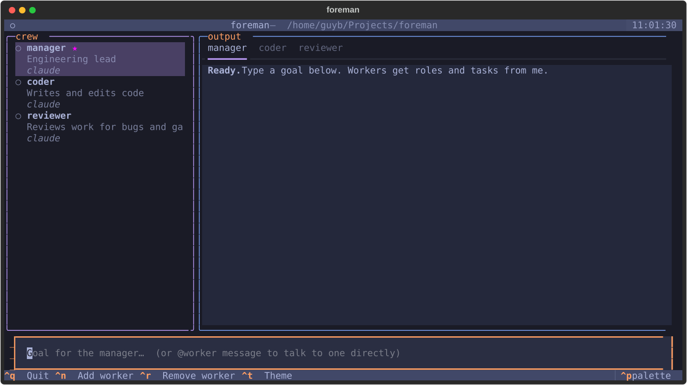

# foreman

A terminal UI for running a crew of AI agents. A **manager** agent reads your goal, gives each **worker** a role and a task, runs them (in parallel, or in steps when one depends on another), and then reviews what they did. If the goal isn't met yet, the manager assigns another round, up to `max_rounds`.



Each agent is a CLI command with `{prompt}` in it, so any agent CLI works: `claude`, `codex`, `opencode`, or your own script. You can mix them, for example a Claude manager running Codex coders.

## Install

```sh
uv tool install git+https://github.com/GbaGuy/foreman
# or from a clone: uv run foreman
```

You need at least one agent CLI installed and logged in.

## Use

Run `foreman` in the directory you want the crew to work in.

| Key / input | What it does |
|---|---|
| type a goal + `Enter` | The manager plans, the workers run, the manager reviews and re-plans until done |
| `@coder fix the tests` | Sends a message straight to one agent |
| `Ctrl+S` | Stops once the running agents finish |
| `Ctrl+N` | Adds a worker: name, default role, backend, command |
| `Ctrl+R` | Removes the selected worker |
| `Enter` on a crew member | Opens that agent's output tab |
| `Ctrl+T` | Switches the colour theme |
| `Ctrl+Q` | Quits |

The sidebar shows each agent's state (○ idle, ◐ working, ● done, ✗ failed) and the role the manager gave it on this run.

## Configure

The crew is saved in `~/.config/foreman/crew.json`. Edit it to change the manager or give agents extra flags:

```json
{
  "max_rounds": 3,
  "manager": {"name": "manager", "command": "claude -p {prompt}", "role": "Engineering lead"},
  "workers": [
    {"name": "coder", "command": "codex exec {prompt}", "role": "Writes and edits code"},
    {"name": "reviewer", "command": "claude -p {prompt}", "role": "Reviews work for bugs"}
  ]
}
```

`max_rounds` (default 3) caps how many plan, work, review rounds one goal can take. Commands run without a shell, and the prompt is passed as a single argument. Each CLI keeps its own permission settings. For example, `claude -p` can't edit files until you add something like `--permission-mode acceptEdits` to its command.

## Develop

```sh
uv run pytest -q
```
